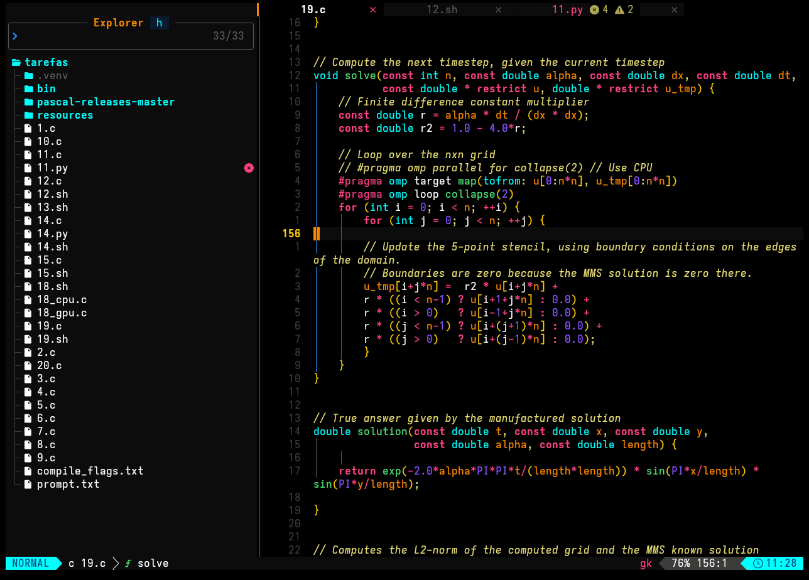

<div align="center">
    
    <br><br>
    <a href="README.md">Português</a> · <strong>English</strong> · <a href="README.es.md">Español</a>
</div>

<br>

**Neolux** is a Monokai-descended Neovim theme so black (`#000000`) your OLED screen will literally think it's unplugged—and only stops there because negative hex codes aren't a thing yet.

Originally meant to be a weekend hobby, it immediately spiraled into an extremely fast, AI-forged bytecode compiler written in a language I genuinely do not code. Built with zero Lua knowledge, an LLM pushed past its thermal limits, and a stubborn refusal to look at grey backgrounds. Use at your own risk (your eyes will thank you; Lua purists will cry).



## Highlights

- **Pure `#000000` contrast**: Pitch-black canvas paired with vibrant, high-readability accents.
- **LuaJIT bytecode compilation**: Atomic on-disk cache with automatic 64-bit hash invalidation.
- **Modern syntax coverage**: Full Tree-sitter, LSP Diagnostics, and LSP Semantic Tokens support.
- **Granular transparency**: Independent surface control for the main editor, floats (`styles.floats`), and sidebars (`styles.sidebars`).
- **22+ plugin integrations**: Automatic `lazy.nvim` detection so you only load highlights for plugins you actually install.
- **Synced terminal & CLI extras**: WezTerm, Ghostty, Kitty, `fzf`, and `tmux` themes generated from a single source of truth (`palette.lua`).

---

## Installation

### 1. Lazy.nvim

Add to `~/.config/nvim/lua/plugins/theme.lua`:

```lua
return {
    {
        "murilodlb/neolux",
        lazy = false,
        priority = 1000,
        config = function()
            require("neolux").setup({})
            vim.cmd("colorscheme neolux")
        end,
    },
}
```

### 2. LazyVim

In `~/.config/nvim/lua/plugins/colorscheme.lua`:

```lua
return {
    {
        "murilodlb/neolux",
        lazy = false,
        priority = 1000,
    },
    {
        "LazyVim/LazyVim",
        opts = {
            colorscheme = "neolux",
        },
    },
}
```

### 3. Native Neovim Packages

```bash
git clone [https://github.com/murilodlb/neolux](https://github.com/murilodlb/neolux) \
  ~/.local/share/nvim/site/pack/themes/start/neolux
```

In your `init.lua`:

```lua
vim.cmd("colorscheme neolux")
```

### 4. Packer.nvim / vim-plug

```lua
-- Packer.nvim
use {
    "murilodlb/neolux",
    config = function()
        vim.cmd("colorscheme neolux")
    end,
}
```

```vim
" vim-plug
Plug 'murilodlb/neolux'
colorscheme neolux
```

---

## Configuration

Call `require("neolux").setup(opts)` before `vim.cmd("colorscheme neolux")`. Defaults shown below:

```lua
require("neolux").setup({
    cache = true,            -- Compile highlights to LuaJIT bytecode
    transparent = false,     -- Clear the main editor background (#000000)
    italic_comments = true,  -- Shorthand for italic comments
    styles = {
        comments = { italic = true },
        keywords = { bold = true },
        functions = {},
        variables = {},
        floats = "dark",     -- "dark" | "transparent" | "normal"
        sidebars = "normal", -- "dark" | "transparent" | "normal"
    },
    on_colors = function(colors)
        -- Override palette colors before highlight resolution
        -- colors.bg = "#050505"
    end,
    on_highlights = function(highlights, colors)
        -- Customize or add specific highlight groups
        -- highlights.CursorLine = { bg = colors.gray2 }
    end,
    plugins = {
        auto = true,         -- Auto-detect installed plugins via lazy.nvim
        -- all = false,      -- Force-load all plugin integrations
        -- telescope = false -- Explicit override by module or repo name
    },
})

vim.cmd("colorscheme neolux")
```

---

## Supported Plugins

When `lazy.nvim` is detected (`plugins.auto = true`), Neolux loads only the modules matching your installed plugins:

| | | |
| :--- | :--- | :--- |
| `blink.cmp` | `bufferline.nvim` | `diffview.nvim` |
| `flash.nvim` | `fzf-lua` | `gitsigns.nvim` |
| `indent-blankline.nvim` | `lazy.nvim` | `lualine.nvim` |
| `mason.nvim` | `mini.nvim` / `mini.*` | `neo-tree.nvim` |
| `noice.nvim` | `nvim-cmp` | `nvim-notify` |
| `nvim-tree.lua` | `rainbow-delimiters.nvim` | `render-markdown.nvim` |
| `snacks.nvim` | `telescope.nvim` | `todo-comments.nvim` |
| `trouble.nvim` | `which-key.nvim` | |

### Lualine

```lua
require("lualine").setup({
    options = {
        theme = "neolux",
    },
})
```

---

## Performance & Bytecode Compilation

On first load, Neolux resolves the palette, editor UI, syntax, plugins, and user callbacks, converts hex colors into 24-bit RGB integers, deduplicates shared highlight tables, and atomically writes a compiled LuaJIT binary (`compiled.luac`) to `stdpath("cache") .. "/neolux"`.

On every subsequent startup, Neovim executes that bytecode directly without even requiring the internal modules. A pure-LuaJIT 64-bit hash automatically invalidates and recompiles the cache whenever your options, callback bytecode/upvalues, installed `lazy.nvim` plugins, or source files under `lua/neolux/` change.

### Benchmarks

Measured via `scripts/benchmark.lua` across 5 fresh Neovim subprocesses (`nvim --clean --headless`) per mode:

| Mode | Median | Min |
| :--- | :---: | :---: |
| Uncached (`cache = false`) | **3.231 ms** | 3.174 ms |
| Cold cache miss (compile + load) | **5.935 ms** | 5.721 ms |
| Warm cache hit (`compiled.luac`) | **1.888 ms** | 1.814 ms |

- **Compiled bytecode size:** `37,928 bytes` (~37 KB)
- **Speedup (uncached vs. warm cache):** **1.71x faster**

Run the benchmark locally:

```bash
nvim --clean --headless -u NONE --cmd "set rtp^=." -c "luafile scripts/benchmark.lua" -c "qa!"
```

---

## Terminal & CLI Extras

All files under `extras/` are generated directly from `lua/neolux/palette.lua` via `scripts/generate_extras.lua` (and verified in CI so they never drift out of sync):

| Tool | File(s) |
| :--- | :--- |
| **WezTerm** | `extras/wezterm/neolux.lua`, `extras/wezterm/neolux.toml` |
| **Ghostty** | `extras/ghostty/neolux`, `extras/ghostty/neolux.conf` |
| **Kitty** | `extras/kitty/neolux.conf` |
| **fzf** | `extras/fzf/neolux.sh` |
| **tmux** | `extras/tmux/neolux.tmux` |

---

## Commands & Healthcheck

| Command | Lua API | Description |
| :--- | :--- | :--- |
| `:NeoluxCompile` | `require("neolux").compile()` | Force recompilation of the bytecode cache. |
| `:NeoluxClean` | `require("neolux").clean()` | Remove `compiled.luac` and `state.txt` from disk. |
| `:checkhealth neolux` | — | Verify Neovim version, `termguicolors`, and cache state. |
| `:help neolux` | — | Open the full Vimdoc documentation inside Neovim. |
