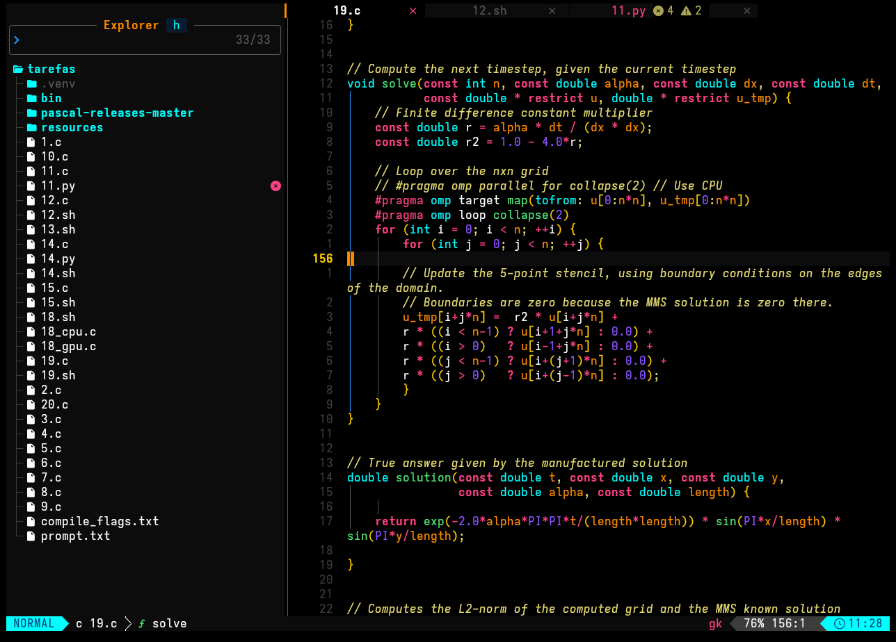

<div align="center">
    
    <br><br>
    <a href="README.md">Português</a> · <a href="README.en.md">English</a> · <strong>Español</strong>
</div>

<br>

**Neolux** es un tema para Neovim descendiente de Monokai tan negro (`#000000`) que tu pantalla OLED literalmente pensará que está desconectada, y solo se detiene ahí porque todavía no existen los códigos hexadecimales negativos.

Lo que iba a ser un hobby relajante de fin de semana se salió de control al instante y terminó convirtiéndose en un compilador de bytecode mui rápido, forjado por IA en un lenguaje que genuinamente no programo. Construido con cero conocimientos de Lua, un LLM llevado más allá de sus límites térmicos y una negativa rotunda a mirar fondos grises. Úsalo bajo tu propio riesgo (tus ojos te lo agradecerán; los puristas de Lua llorarán).



## Aspectos Destacados

- **Contraste extremo en `#000000`**: Fondo negro puro combinado con acentos vibrantes de alta legibilidad.
- **Compilación a bytecode LuaJIT**: Caché atómica en disco con invalidación automática mediante hash de 64 bits.
- **Cobertura moderna de sintaxis**: Soporte completo para Tree-sitter, LSP Diagnostics y LSP Semantic Tokens.
- **Transparencia granular**: Control independiente para el editor principal, ventanas flotantes (`styles.floats`) y barras laterales (`styles.sidebars`).
- **22+ integraciones de plugins**: Detección automática con `lazy.nvim` para cargar únicamente los plugins que realmente usas.
- **Extras sincronizados de terminal y CLI**: Temas para WezTerm, Ghostty, Kitty, `fzf` y `tmux` generados desde una única fuente de verdad (`palette.lua`).

---

## Instalación

### 1. Lazy.nvim

Añade en `~/.config/nvim/lua/plugins/theme.lua`:

```lua
return {
    {
        "murilodlb/neolux",
        lazy = false,
        priority = 1000,
        config = function()
            require("neolux").setup({})
            vim.cmd("colorscheme neolux")
        end,
    },
}
```

### 2. LazyVim

En `~/.config/nvim/lua/plugins/colorscheme.lua`:

```lua
return {
    {
        "murilodlb/neolux",
        lazy = false,
        priority = 1000,
    },
    {
        "LazyVim/LazyVim",
        opts = {
            colorscheme = "neolux",
        },
    },
}
```

### 3. Paquetes Nativos de Neovim

```bash
git clone [https://github.com/murilodlb/neolux](https://github.com/murilodlb/neolux) \
  ~/.local/share/nvim/site/pack/themes/start/neolux
```

En tu `init.lua`:

```lua
vim.cmd("colorscheme neolux")
```

### 4. Packer.nvim / vim-plug

```lua
-- Packer.nvim
use {
    "murilodlb/neolux",
    config = function()
        vim.cmd("colorscheme neolux")
    end,
}
```

```vim
" vim-plug
Plug 'murilodlb/neolux'
colorscheme neolux
```

---

## Configuración

Llama a `require("neolux").setup(opts)` antes de `vim.cmd("colorscheme neolux")`. Valores por defecto:

```lua
require("neolux").setup({
    cache = true,            -- Compila los highlights a bytecode LuaJIT
    transparent = false,     -- Elimina el fondo (#000000) del editor principal
    italic_comments = true,  -- Atajo para cursiva en comentarios
    styles = {
        comments = { italic = true },
        keywords = { bold = true },
        functions = {},
        variables = {},
        floats = "dark",     -- "dark" | "transparent" | "normal"
        sidebars = "normal", -- "dark" | "transparent" | "normal"
    },
    on_colors = function(colors)
        -- Sobrescribe colores de la paleta antes de generar los highlights
        -- colors.bg = "#050505"
    end,
    on_highlights = function(highlights, colors)
        -- Personaliza o añade grupos de highlight específicos
        -- highlights.CursorLine = { bg = colors.gray2 }
    end,
    plugins = {
        auto = true,         -- Detecta automáticamente los plugins en lazy.nvim
        -- all = false,      -- Fuerza la carga de todas las integraciones
        -- telescope = false -- Sobrescritura explícita por módulo o repositorio
    },
})

vim.cmd("colorscheme neolux")
```

---

## Plugins Soportados

Cuando `lazy.nvim` está activo (`plugins.auto = true`), Neolux solo carga los módulos correspondientes a tus plugins instalados:

| | | |
| :--- | :--- | :--- |
| `blink.cmp` | `bufferline.nvim` | `diffview.nvim` |
| `flash.nvim` | `fzf-lua` | `gitsigns.nvim` |
| `indent-blankline.nvim` | `lazy.nvim` | `lualine.nvim` |
| `mason.nvim` | `mini.nvim` / `mini.*` | `neo-tree.nvim` |
| `noice.nvim` | `nvim-cmp` | `nvim-notify` |
| `nvim-tree.lua` | `rainbow-delimiters.nvim` | `render-markdown.nvim` |
| `snacks.nvim` | `telescope.nvim` | `todo-comments.nvim` |
| `trouble.nvim` | `which-key.nvim` | |

### Lualine

```lua
require("lualine").setup({
    options = {
        theme = "neolux",
    },
})
```

---

## Rendimiento y Compilación a Bytecode

En la primera carga, Neolux resuelve la paleta, la interfaz del editor, la sintaxis, los plugins y los callbacks del usuario, convierte los colores hex en enteros RGB de 24 bits, deduplica tablas repetidas y escribe de forma atómica un binario LuaJIT (`compiled.luac`) en `stdpath("cache") .. "/neolux"`.

En los arranques siguientes, Neovim ejecuta directamente ese bytecode sin siquiera cargar los módulos internos con `require`. Un hash de 64 bits en LuaJIT invalida y recompila la caché automáticamente cada vez que cambian tus opciones, el bytecode/upvalues de tus callbacks, los plugins de `lazy.nvim` o los archivos fuente en `lua/neolux/`.

### Benchmarks

Medido con `scripts/benchmark.lua` en 5 subprocesos limpios de Neovim (`nvim --clean --headless`) por modo:

| Modo | Mediana | Mínimo |
| :--- | :---: | :---: |
| Sin caché (`cache = false`) | **3.231 ms** | 3.174 ms |
| Caché fría (compilación + carga) | **5.935 ms** | 5.721 ms |
| Caché caliente (`compiled.luac`) | **1.888 ms** | 1.814 ms |

- **Tamaño del bytecode compilado:** `37,928 bytes` (~37 KB)
- **Aceleración (sin caché vs. caché caliente):** **1.71x más rápido**

Para ejecutar el benchmark en tu máquina:

```bash
nvim --clean --headless -u NONE --cmd "set rtp^=." -c "luafile scripts/benchmark.lua" -c "qa!"
```

---

## Extras (Terminales y CLI)

Todos los archivos en `extras/` se generan automáticamente desde `lua/neolux/palette.lua` mediante `scripts/generate_extras.lua` (y se validan en CI para evitar cualquier desfase):

| Herramienta | Archivo(s) |
| :--- | :--- |
| **WezTerm** | `extras/wezterm/neolux.lua`, `extras/wezterm/neolux.toml` |
| **Ghostty** | `extras/ghostty/neolux`, `extras/ghostty/neolux.conf` |
| **Kitty** | `extras/kitty/neolux.conf` |
| **fzf** | `extras/fzf/neolux.sh` |
| **tmux** | `extras/tmux/neolux.tmux` |

---

## Comandos y Diagnóstico

| Comando | API Lua | Descripción |
| :--- | :--- | :--- |
| `:NeoluxCompile` | `require("neolux").compile()` | Fuerza la recompilación de la caché de bytecode. |
| `:NeoluxClean` | `require("neolux").clean()` | Elimina `compiled.luac` y `state.txt` del disco. |
| `:checkhealth neolux` | — | Verifica la versión de Neovim, `termguicolors` y el estado de la caché. |
| `:help neolux` | — | Abre la documentación completa dentro de Neovim. |
