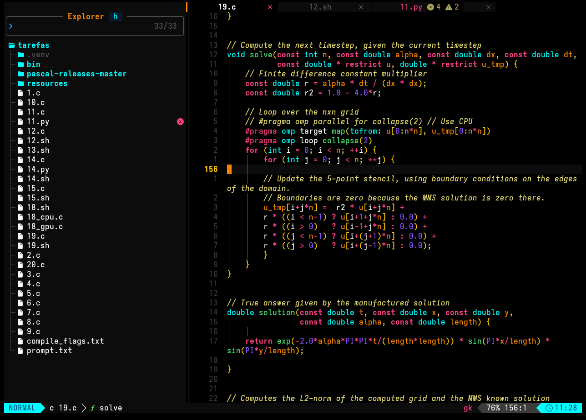

<div align="center">
    
    <br><br>
    <strong>Português</strong> · <a href="README.en.md">English</a> · <a href="README.es.md">Español</a>
</div>

<br>

O **Neolux** é um tema para Neovim derivado do Monokai tão preto (`#000000`) que sua tela OLED vai achar que foi tirada da tomada, e só para por aí porque ainda não inventaram hex code negativo.

O que era pra ser um hobby de fim de semana saiu completamente do controle e virou um compilador de bytecode extremamente rápido, forjado por IA em uma linguagem que eu legitimamente não programo. Construído com zero conhecimento em Lua, uma LLM empurrada além dos seus limites térmicos e uma recusa teimosa de olhar para fundos cinzas. Use por sua conta e risco (seus olhos vão agradecer; puristas de Lua vão chorar).



## Destaques

- **Contraste extremo em `#000000`**: Fundo preto puro com realces vibrantes otimizados para legibilidade.
- **Compilação para bytecode LuaJIT**: Cache nativo em disco com escrita atômica e invalidação automática via hash de 64 bits.
- **Cobertura moderna de sintaxe**: Suporte completo a Tree-sitter, LSP Diagnostics e LSP Semantic Tokens.
- **Transparência granular**: Controle independente para editor principal, janelas flutuantes (`styles.floats`) e barras laterais (`styles.sidebars`).
- **22+ integrações de plugins**: Detecção automática com `lazy.nvim` para carregar apenas o que você usa.
- **Extras de terminal sincronizados**: Temas para WezTerm, Ghostty, Kitty, `fzf` e `tmux` gerados a partir de uma única fonte de verdade (`palette.lua`).

---

## Instalação

### 1. Lazy.nvim

Adicione em `~/.config/nvim/lua/plugins/theme.lua`:

```lua
return {
    {
        "murilodlb/neolux",
        lazy = false,
        priority = 1000,
        config = function()
            require("neolux").setup({})
            vim.cmd("colorscheme neolux")
        end,
    },
}
```

### 2. LazyVim

Em `~/.config/nvim/lua/plugins/colorscheme.lua`:

```lua
return {
    {
        "murilodlb/neolux",
        lazy = false,
        priority = 1000,
    },
    {
        "LazyVim/LazyVim",
        opts = {
            colorscheme = "neolux",
        },
    },
}
```

### 3. Pacote Nativo do Neovim

```bash
git clone [https://github.com/murilodlb/neolux](https://github.com/murilodlb/neolux) \
  ~/.local/share/nvim/site/pack/themes/start/neolux
```

No seu `init.lua`:

```lua
vim.cmd("colorscheme neolux")
```

### 4. Packer.nvim / vim-plug

```lua
-- Packer.nvim
use {
    "murilodlb/neolux",
    config = function()
        vim.cmd("colorscheme neolux")
    end,
}
```

```vim
" vim-plug
Plug 'murilodlb/neolux'
colorscheme neolux
```

---

## Configuração

Chame `require("neolux").setup(opts)` antes de `vim.cmd("colorscheme neolux")`. Estes são os valores padrão:

```lua
require("neolux").setup({
    cache = true,            -- Compila os highlights para bytecode LuaJIT
    transparent = false,     -- Remove o fundo (#000000) do editor principal
    italic_comments = true,  -- Atalho para itálico em comentários
    styles = {
        comments = { italic = true },
        keywords = { bold = true },
        functions = {},
        variables = {},
        floats = "dark",     -- "dark" | "transparent" | "normal"
        sidebars = "normal", -- "dark" | "transparent" | "normal"
    },
    on_colors = function(colors)
        -- Sobrescreva cores da paleta antes de gerar os highlights
        -- colors.bg = "#050505"
    end,
    on_highlights = function(highlights, colors)
        -- Personalize ou adicione grupos de highlight específicos
        -- highlights.CursorLine = { bg = colors.gray2 }
    end,
    plugins = {
        auto = true,         -- Detecta automaticamente plugins no lazy.nvim
        -- all = false,      -- Força o carregamento de todas as integrações
        -- telescope = false -- Sobrescrita manual por módulo ou repositório
    },
})

vim.cmd("colorscheme neolux")
```

---

## Plugins Suportados

Quando o `lazy.nvim` está presente (`plugins.auto = true`), o Neolux ativa apenas os módulos dos plugins realmente instalados:

| | | |
| :--- | :--- | :--- |
| `blink.cmp` | `bufferline.nvim` | `diffview.nvim` |
| `flash.nvim` | `fzf-lua` | `gitsigns.nvim` |
| `indent-blankline.nvim` | `lazy.nvim` | `lualine.nvim` |
| `mason.nvim` | `mini.nvim` / `mini.*` | `neo-tree.nvim` |
| `noice.nvim` | `nvim-cmp` | `nvim-notify` |
| `nvim-tree.lua` | `rainbow-delimiters.nvim` | `render-markdown.nvim` |
| `snacks.nvim` | `telescope.nvim` | `todo-comments.nvim` |
| `trouble.nvim` | `which-key.nvim` | |

### Lualine

```lua
require("lualine").setup({
    options = {
        theme = "neolux",
    },
})
```

---

## Performance e Compilação de Bytecode

Na primeira carga, o Neolux resolve paleta, editor, sintaxe, plugins e callbacks do usuário, converte cores hex em inteiros RGB de 24 bits, deduplica tabelas compartilhadas e grava um binário LuaJIT (`compiled.luac`) atomicamente em `stdpath("cache") .. "/neolux"`.

Nas inicializações seguintes, o Neovim executa o bytecode diretamente — sem sequer dar `require` nos módulos internos. Um hash de 64 bits em LuaJIT invalida o cache automaticamente sempre que suas opções, upvalues/bytecode de callbacks, plugins do `lazy.nvim` ou arquivos em `lua/neolux/` mudam.

### Benchmarks

Medido com `scripts/benchmark.lua` em 5 subprocessos limpos do Neovim (`nvim --clean --headless`) por modo:

| Modo | Mediana | Mínimo |
| :--- | :---: | :---: |
| Sem cache (`cache = false`) | **3.231 ms** | 3.174 ms |
| Cache frio (primeira compilação) | **5.935 ms** | 5.721 ms |
| Cache quente (`compiled.luac`) | **1.888 ms** | 1.814 ms |

- **Tamanho do bytecode compilado:** `37,928 bytes` (~37 KB)
- **Ganho de velocidade (sem cache vs. cache quente):** **1.71x mais rápido**

Para reproduzir na sua máquina:

```bash
nvim --clean --headless -u NONE --cmd "set rtp^=." -c "luafile scripts/benchmark.lua" -c "qa!"
```

---

## Extras (Terminais e CLI)

Todos os arquivos em `extras/` são gerados automaticamente a partir de `lua/neolux/palette.lua` via `scripts/generate_extras.lua` (validados em CI para nunca ficarem dessincronizados):

| Ferramenta | Arquivo(s) |
| :--- | :--- |
| **WezTerm** | `extras/wezterm/neolux.lua`, `extras/wezterm/neolux.toml` |
| **Ghostty** | `extras/ghostty/neolux`, `extras/ghostty/neolux.conf` |
| **Kitty** | `extras/kitty/neolux.conf` |
| **fzf** | `extras/fzf/neolux.sh` |
| **tmux** | `extras/tmux/neolux.tmux` |

---

## Comandos e Diagnóstico

| Comando | API Lua | Descrição |
| :--- | :--- | :--- |
| `:NeoluxCompile` | `require("neolux").compile()` | Força a recompilação do cache em bytecode. |
| `:NeoluxClean` | `require("neolux").clean()` | Remove `compiled.luac` e `state.txt` do disco. |
| `:checkhealth neolux` | — | Valida versão do Neovim, `termguicolors` e status do cache. |
| `:help neolux` | — | Abre a documentação completa no Neovim. |
