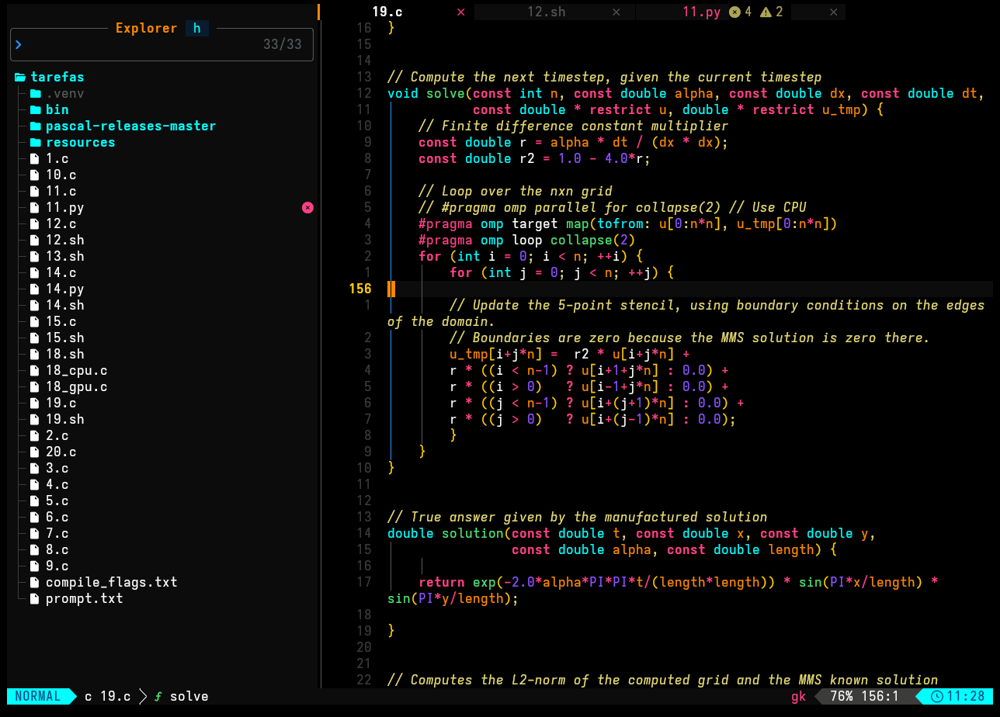

<div align="center">
    
</div>
<br>
<br>

Um tema desenvolvido inteiramente em Lua puro para o Neovim, baseado no Monokai, oferecendo uma experiência visual de alto contraste com fundo puramente preto (`#000000`) e realces vibrantes. Esse tema só não é mais escuro porque não tem como usar hex code negativo.



## Instalação e Configuração

### 1. Lazy.nvim

Adicione o seguinte spec em sua configuração — normalmente em `~/.config/nvim/lua/plugins/theme.lua`:

```lua
return {
    {
        "murilodlb/neolux",
        lazy = false,
        priority = 1000,
        config = function()
            vim.cmd("colorscheme neolux")
        end,
    },
}
```

### 2. LazyVim

Se você usa a distribuição [LazyVim](https://www.lazyvim.org/), crie (ou edite) o arquivo `~/.config/nvim/lua/plugins/colorscheme.lua` e adicione:

```lua
return {
    {
        "murilodlb/neolux",
        lazy = false,
        priority = 1000,
        config = function()
            vim.cmd("colorscheme neolux")
        end,
    },
    -- Desabilita o tema padrão do LazyVim
    { "folke/tokyonight.nvim", enabled = false },
}
```

Em seguida, abra o Neovim e execute `:Lazy sync` para instalar.

> **Dica:** O LazyVim carrega automaticamente todos os arquivos dentro de `lua/plugins/`, então nenhuma configuração extra é necessária.

### 3. Neovim

Você pode instalar manualmente clonando o repositório diretamente na pasta de pacotes nativa do Neovim:

```bash
# Linux / macOS
git clone https://github.com/murilodlb/neolux \
  ~/.local/share/nvim/site/pack/themes/start/neolux
```

Depois, adicione em seu `~/.config/nvim/init.lua`:

```lua
vim.cmd("colorscheme neolux")
```

Ou, se ainda usar `init.vim`:

```vim
colorscheme neolux
```

### 4. Packer.nvim

```lua
use {
    "murilodlb/neolux",
    config = function()
        vim.cmd("colorscheme neolux")
    end,
}
```

Após salvar o arquivo, execute `:PackerSync` dentro do Neovim.

### 5. vim-plug

```vim
Plug 'murilodlb/neolux'
```

Após adicionar a linha acima entre `call plug#begin()` e `call plug#end()`, execute `:PlugInstall`. Em seguida, adicione ao final do seu `init.vim`:

```vim
colorscheme neolux
```

---

## Lualine

Para garantir que a barra de status combine perfeitamente com o tema, configure o [lualine.nvim](https://github.com/nvim-lualine/lualine.nvim) para utilizar o perfil do neolux.

**Com Lazy.nvim / LazyVim** — em `lua/plugins/lualine.lua`:

```lua
return {
    "nvim-lualine/lualine.nvim",
    opts = {
        options = {
            theme = "neolux",
        },
    },
}
```

**Com Packer / configuração manual** — em `init.lua`:

```lua
require("lualine").setup({
    options = {
        theme = "neolux",
    },
})
```

---

## Compilação de Bytecode e Cache (Performance)

Para garantir um tempo de inicialização ultrarrápido, o **Neolux** conta com um sistema nativo de compilação para **bytecode LuaJIT** (inspirado no *Catppuccin*).

### Como funciona?
Na primeira vez em que o tema é carregado, o Neolux resolve todas as cores da paleta, grupos do editor, árvores sintáticas (Treesitter/LSP), integrações de plugins e customizações do usuário, compilando todas as chamadas `nvim_set_hl` em um único arquivo binário otimizado (`compiled.luac`) salvo no diretório de cache do Neovim (`stdpath("cache") .. "/neolux"`).

Nas inicializações seguintes, o Neolux carrega diretamente esse bytecode pré-compilado — sem precisar carregar os módulos internos (`editor`, `syntax`, `plugins/*`) ou mesclar tabelas em tempo de execução, reduzindo o tempo de carregamento em **mais de 55%**.

### Invalidação Automática
Você **não** precisa recompilar manualmente quando alterar sua configuração. O Neolux gera automaticamente uma assinatura **SHA-256** baseada em:
- Suas opções definidas em `require("neolux").setup({...})`;
- O bytecode das funções de callback `on_colors` e `on_highlights`;
- A lista de plugins instalados no `lazy.nvim`;
- A data de modificação (`mtime`) dos arquivos-fonte do tema.

Qualquer alteração em um desses fatores invalida o cache e recompila o tema automaticamente na próxima inicialização.

### Configuração
O cache já vem **ativado por padrão** (`cache = true`). Caso queira configurá-lo explicitamente ou desativá-lo:

```lua
require("neolux").setup({
    cache = true, -- Padrão: true (defina como false para desativar o cache em bytecode)
})
vim.cmd("colorscheme neolux")
```

### Comandos Disponíveis

| Comando | API Lua Equivalente | Descrição |
| :--- | :--- | :--- |
| `:NeoluxCompile` | `require("neolux").compile()` | Força a recompilação imediata dos grupos de destaque para o cache em bytecode. |
| `:NeoluxClean` | `require("neolux").clean()` | Remove os arquivos de cache compilados (`compiled.luac` e `state.txt`). |
